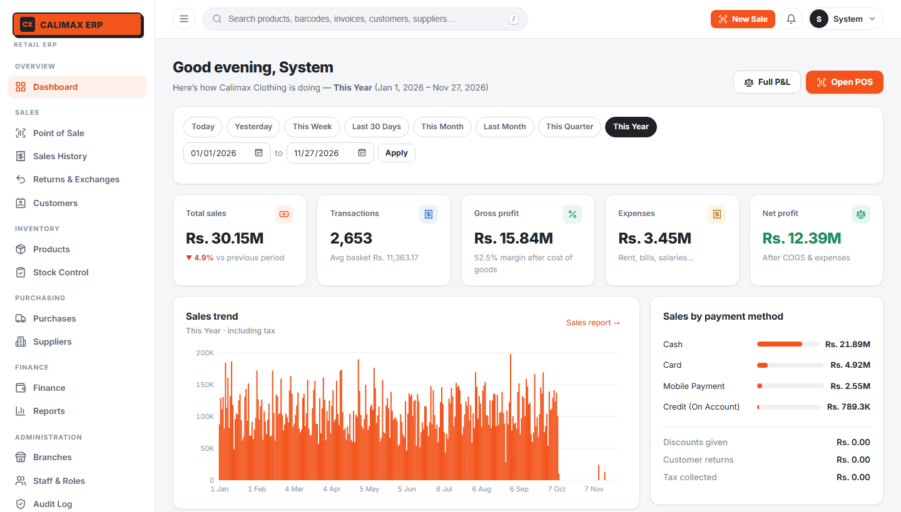
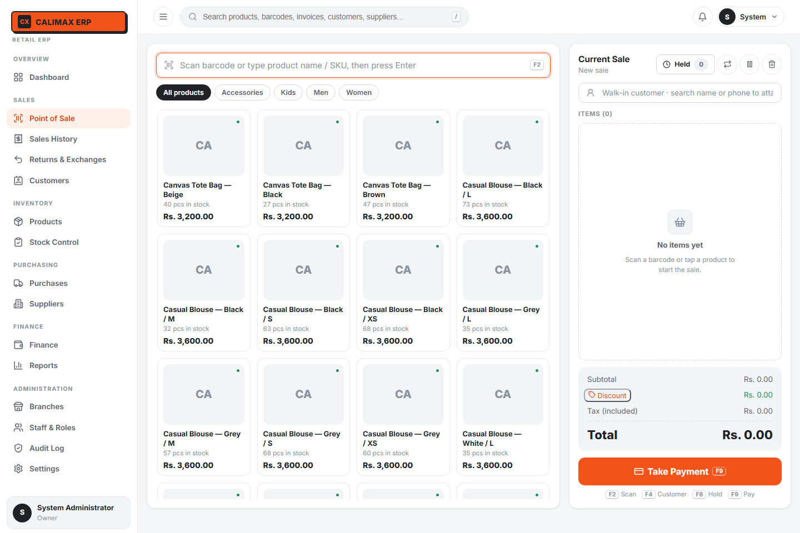
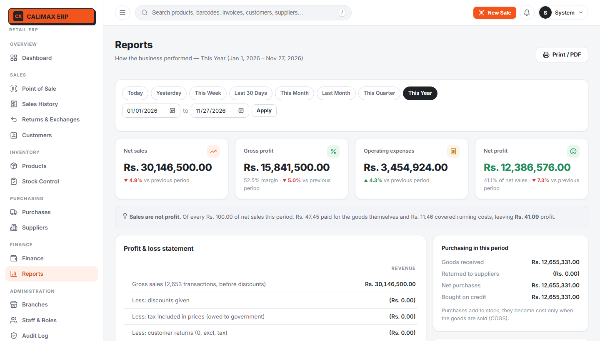
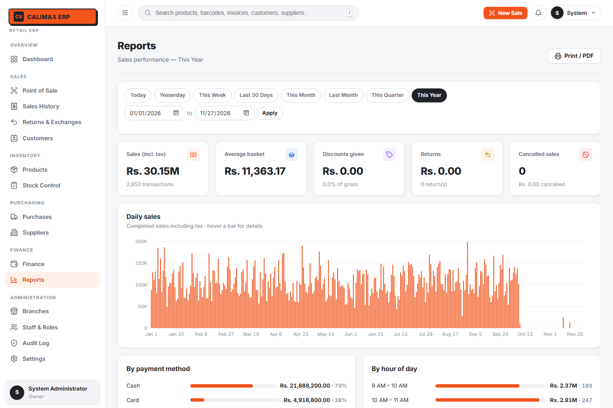
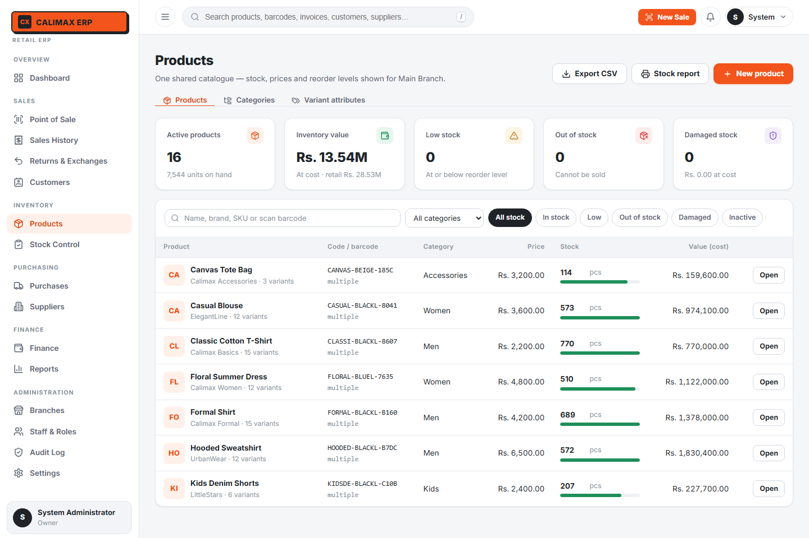
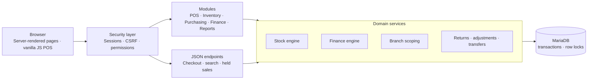

<div align="center">

# Calimax Retail ERP

### Multi-branch retail ERP and point of sale — from supplier order to net profit

**Designed and engineered by [Mohammed Jamaal Rushdi](https://github.com/mojamaal) · AI Full-Stack Engineer**


[Highlights](#-engineering-highlights) · [Screens](#-product-tour) · [Features](#-what-it-does) · [Architecture](#-architecture) · [About me](#-about-me)

</div>



---

## 🎯 The problem

Many shops know what they **sold** today but not what they **earned**. Stock lives in one spreadsheet, supplier debts in a notebook, expenses in a drawer of receipts, and a second branch doubles the confusion.

**Calimax** puts the whole operation in one system: purchasing, stock, checkout, returns, customers, suppliers, money and reporting, for one shop or many branches. It is built for Sri Lankan retail (LKR, VAT/TIN, cash-heavy tills, credit customers) and suits groceries, electronics, clothing, cosmetics and hardware.

| **94** PHP modules | **40** database tables | **12,000+** lines of first-party code | **5** staff roles | **0** frameworks |
|:---:|:---:|:---:|:---:|:---:|

## ⭐ Engineering highlights

The parts I'd most like to talk about in an interview:

| Challenge | How I solved it |
|---|---|
| **Two tills selling the last item at once** | Checkout runs in one transaction with row-level locks; a single stock engine writes every movement with its running balance |
| **Never trusting the browser** | The server re-derives every price, cost, tax and discount at checkout, so a tampered request cannot under-charge or skip an approval |
| **Profit that stays correct over time** | Each sale line stores the cost at the moment of sale; weighted-average cost updates on every goods receipt, so later price changes never rewrite history |
| **Many branches, one catalogue** | Per-branch stock, prices, cost, cash books and supplier balances over shared products, all driven by one scoping layer so every report works per branch or consolidated |
| **Stock that moves between branches** | Transfers are tracked in transit, received by count, and any shortfall returns to the sender, so units are never silently lost |
| **Duplicate invoice numbers** | Atomic, race-safe sequences with a separate series per branch |
| **Real-world control without slowing the queue** | Five roles with granular permissions, plus on-the-spot manager authorisation for voids, large discounts and refunds |
| **Accountability** | An audit trail of who changed a price, adjusted stock, refunded, cancelled or approved, and when |
| **Upgrading a live database** | An idempotent migration script that adds to an existing schema and is safe to run repeatedly |

## 🖼 Product tour

<sub>All figures shown are generated demo data.</sub>

### Point of sale
Barcode-first checkout with keyboard shortcuts, split payments, held carts, customer credit and exchange credit.



### Profit & loss
Revenue is not profit: net sales, cost of goods, stock losses and operating expenses, compared with the previous period.



<table>
<tr>
<td width="50%"><b>Sales analytics</b><br></td>
<td width="50%"><b>Product catalogue</b><br></td>
</tr>
</table>

## 🧩 What it does

| Module | Capabilities |
|---|---|
| **Products** | Variants (size, colour), own SKU and barcode, label printing, margins, reorder levels, price history |
| **Suppliers** | Profiles, payment terms, account statements, payments by cash, bank or cheque |
| **Purchasing** | Purchase orders, partial and direct goods receipt, rejected items, cost changes, returns to supplier |
| **Inventory** | Saleable and damaged stock, adjustments with approval, blind stock counts, full movement history |
| **Point of sale** | Line and bill discounts, tax-inclusive or exclusive pricing, split tender, change calculation, receipts |
| **Customers** | Purchase history, credit limits, statements, payment collection |
| **Returns & exchanges** | Approval workflow, condition tracking, defective items kept off the shelf |
| **Finance** | Expenses, cash and bank book, receivables and payables with ageing |
| **Reports** | Dashboard, P&L, sales, product performance, inventory valuation, tax, branch comparison, printable PDFs |
| **Multi-branch** | Branch switcher, per-branch pricing and supplier bills, inter-branch transfers, consolidated view |
| **Administration** | Staff and roles, settings, searchable audit log with CSV export |

### Business rules enforced in code
- A purchase order **never** changes stock. Only a goods receipt does.
- A defective return **never** goes back on the shelf.
- A cancelled sale needs a **reason** and an **authorised** person.
- A cashier cannot exceed their discount limit without a manager.

## 🏗 Architecture



```text
api/         JSON endpoints used by the POS and search
includes/    auth, branches, stock, finance, returns, transfers, shared UI
pos/         checkout, sales history, returns
inventory/   products, adjustments, counts, transfers
purchase/    orders, goods receipt, suppliers
finance/     expenses, cash and bank, receivables, payables
reports/     P&L, sales, products, inventory, tax, branches
database/    schema, migration, demo data generator
```

**Security:** role-based access control, branch isolation, CSRF protection, prepared statements, output escaping, hashed passwords, login lockout and a full audit trail.

**Stack:** PHP 8.2 · PDO · MariaDB / MySQL · HTML & CSS design system · vanilla JavaScript · Apache. Third-party assets: Lucide icons and JsBarcode.

## 👨‍💻 About me

I'm **Mohammed Jamaal Rushdi**, an **AI Full-Stack Engineer**. I build complete products, not just features: I take a messy business process and turn it into software that is simple for the person at the counter and correct underneath.

**What this project demonstrates**
- **Product thinking** — workflows modelled on how owners, managers, cashiers and store staff really work
- **Database design** — a normalised schema with transactional integrity for stock and money
- **Backend engineering** — domain services, authorisation, concurrency control and safe migrations
- **Frontend and UX** — a fast, keyboard-friendly POS and a consistent, responsive interface
- **Ownership** — from data model to dashboard, delivered end to end

📫 **Open to AI and full-stack engineering roles.** Reach me through [github.com/mojamaal](https://github.com/mojamaal).

<details>
<summary><b>Local setup (requires written permission, see licence)</b></summary>

1. Place the project in `htdocs/calipos` (XAMPP or any Apache + PHP 8.2 + MariaDB stack)
2. Import `database/schema.sql`
3. Run `php database/migrate.php`
4. Optional demo data: `php database/seed_demo.php`
5. Check `config/config.php`, open `http://localhost/calipos`, and change the default administrator password immediately

</details>

## 🔒 Licence

**© 2026 Mohammed Jamaal Rushdi. All Rights Reserved.**

This repository is public for **portfolio review only**. It is **not** open source. Using, running, copying, modifying, deploying, distributing or commercialising it is not permitted without prior written permission. See [LICENSE](LICENSE).
